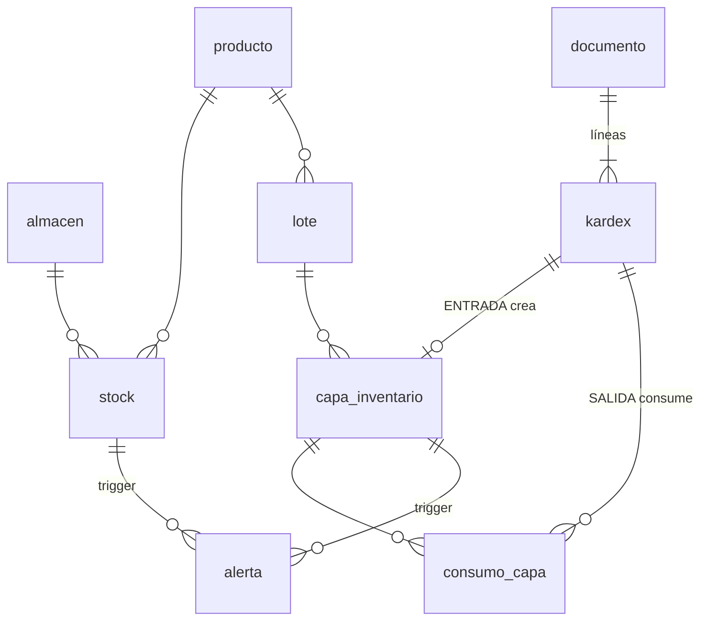

# Sistema de Gestión Comercial — Stock e Inventario

Motor de inventario **multialmacén** implementado íntegramente en **PostgreSQL 15+**
con lógica de negocio dentro de la base de datos: kardex valorizado
(**Promedio Ponderado** y **PEPS**), procedimientos almacenados, triggers,
control de **lotes y vencimientos**, **transferencias** y **alertas automáticas**.

El principio rector: **es imposible tener stock negativo**, sin importar desde
dónde se intente (procedimiento, `INSERT` directo, `UPDATE` manual o sesiones
concurrentes).

## Inicio rápido

```bash
# Opción A: Docker (PostgreSQL 16 + datos de demostración)
docker compose up -d
docker compose exec db psql -U inventario -d inventario

# Opción B: PostgreSQL local
createdb inventario
./install.sh inventario --demo

# Pruebas (crean y eliminan una base temporal)
tests/run_tests.sh
```

```sql
SET search_path = inventario;

-- Compra con lotes perecibles
CALL sp_registrar_entrada('COMPRA', 1, '[
  {"producto":"LEC-001","cantidad":200,"costo_unitario":3.10,
   "lote":"LEC-0925","fecha_vencimiento":"2026-12-20"}]', 'F001-000123');

-- Venta (el sistema elige lotes por FEFO/PEPS y descarta los vencidos)
CALL sp_registrar_salida('VENTA', 1, '[{"producto":"LEC-001","cantidad":30}]', 'B001-4512');

-- Transferencia: el lote, el vencimiento y el costo viajan con la mercadería
CALL sp_transferir(1, 2, '[{"producto":"LEC-001","cantidad":50}]', 'GR-0001');

SELECT * FROM fn_reporte_kardex('LEC-001', 1);   -- kardex valorizado
SELECT * FROM v_stock_por_lote;                    -- existencias con semáforo de vencimiento
SELECT * FROM v_alertas_activas;                   -- stock mínimo, agotado, por vencer, vencido
SELECT * FROM fn_verificar_integridad();           -- vacío = base consistente
```

## Arquitectura



| Tabla | Rol |
|---|---|
| `documento` | Cabecera: compra, venta, transferencia, merma, inventario físico, anulación… |
| `kardex` | **Libro mayor inmutable.** Una fila por movimiento con costo y saldo valorizado. |
| `capa_inventario` | Capas de costo / existencias por lote. Cada entrada crea una; las salidas las consumen. |
| `consumo_capa` | Trazabilidad: qué lotes y a qué costo consumió cada salida. |
| `stock` | Saldo por almacén-producto (cantidad, valor, costo promedio, stock mínimo). |
| `alerta` | Alertas abiertas/resueltas, gestionadas solo por triggers. |

### Flujo de un movimiento

```
CALL sp_registrar_salida(...)                       ← procedimiento almacenado
  ├─ fn_bloquear_saldos()      bloquea filas de stock en orden canónico (sin deadlocks)
  ├─ INSERT documento
  └─ INSERT kardex  ──► trg_kardex_procesar (BEFORE INSERT)
                          ├─ valida producto, almacén, lote, cronología
                          ├─ SELECT … FOR UPDATE sobre stock
                          ├─ consume capas (PEPS o FEFO), excluye lotes vencidos
                          ├─ RAISE si no alcanza  →  rollback de TODO el documento
                          ├─ valoriza (promedio ponderado / PEPS)
                          └─ UPDATE stock  ──► trg_stock_alerta  (stock mínimo / agotado)
                                     capa  ──► trg_capa_alerta   (lote por vencer / vencido)
```

## Kardex valorizado

Cada línea registra entrada/salida (cantidad, costo unitario, costo total) y el
saldo resultante (cantidad, costo unitario, valor). El método es por producto
(`producto.metodo_valuacion`).

**Promedio ponderado** — en cada entrada `CPP = (valor_saldo + costo_entrada) / (cant_saldo + cant_entrada)`;
las salidas se valorizan al CPP vigente y no lo modifican.

| Operación | Cant. | C.U. | Total | Saldo cant. | CPP | Saldo valor |
|---|---:|---:|---:|---:|---:|---:|
| Compra | 100 | 10.00 | 1 000 | 100 | 10.00 | 1 000 |
| Compra | 50 | 13.00 | 650 | 150 | 11.00 | 1 650 |
| Venta | 120 | 11.00 | 1 320 | 30 | 11.00 | 330 |
| Compra | 70 | 14.00 | 980 | 100 | 13.10 | 1 310 |

**PEPS (FIFO)** — las salidas consumen las capas más antiguas; el costo de una
salida es la suma de las capas consumidas (`100×10 + 20×13 = 1 260` en el
mismo ejemplo). Ambos casos están verificados en `tests/test_inventario.sql`.

Detalles de precisión: costos unitarios con 6 decimales y valores con 4. Cuando
una salida agota el saldo se lleva **todo** el valor restante, por lo que nunca
quedan residuos de redondeo (stock 0 ⇒ valor 0, garantizado por un `CHECK`).

## Garantías de integridad

| Garantía | Mecanismo |
|---|---|
| Stock nunca negativo | Validación en trigger + `CHECK (cantidad >= 0)` en `stock` y capas |
| Sin carreras entre sesiones | `SELECT … FOR UPDATE` del saldo; bloqueo previo en orden canónico |
| Sin interbloqueos en transferencias cruzadas | `fn_bloquear_saldos` ordena por (almacén, producto) |
| Documentos atómicos | Todo el documento en una transacción; una línea inválida revierte todo |
| Kardex inmutable | Triggers bloquean `UPDATE`, `DELETE` y `TRUNCATE` |
| Saldos no manipulables | `stock` y `capa_inventario` solo aceptan cambios del motor del kardex |
| Kardex cronológico | Se rechazan movimientos retroactivos; sin fecha explícita se usa la hora real tras obtener el bloqueo |
| Lotes coherentes | FK compuesta `(lote_id, producto_id)`; un lote existente no puede cambiar de vencimiento |
| Mercadería vencida | No se vende ni transfiere; solo se retira con `MERMA` / `AJUSTE_NEGATIVO` |
| Correcciones auditables | `sp_anular_documento` genera movimientos inversos; nunca se borra historia |
| Auditoría | `fn_verificar_integridad()` cruza stock, capas y kardex |

Las rutinas fijan su propio `search_path`, de modo que funcionan igual
independientemente de la configuración de la sesión que las invoque.

## Operativa multialmacén y lotes

- **Selección de lotes:** productos PEPS consumen por antigüedad de ingreso;
  productos de promedio ponderado usan **FEFO** (primero el que vence antes),
  ya que allí el lote no afecta el costo. Se puede indicar un lote explícito.
- **Transferencias:** la salida del origen se valoriza con su método y la
  entrada en destino replica cada lote consumido con su vencimiento y costo
  (PEPS: costo exacto de la capa; promedio: CPP del origen). El valor total del
  inventario no cambia.
- **Anulaciones:** anular una venta devuelve las unidades a **sus capas
  originales** a su costo exacto (se preserva el orden PEPS). Una compra solo
  se anula si su capa sigue íntegra (si ya se vendió, primero se anula la venta).
- **Inventario físico:** `sp_inventario_fisico` compara el conteo (por producto
  o por lote) y genera los ajustes positivos/negativos.

## Alertas automáticas

| Alerta | Disparo | Se resuelve sola cuando |
|---|---|---|
| `STOCK_MINIMO` | Saldo ≤ stock mínimo del almacén | El saldo supera el mínimo |
| `STOCK_AGOTADO` | El saldo llega a 0 | Ingresa stock |
| `LOTE_POR_VENCER` | Vence dentro de `producto.dias_alerta_vencimiento` | Se agota el lote o escala a vencido |
| `LOTE_VENCIDO` | Fecha de vencimiento superada | Se retira todo el lote del almacén |

Las de stock se evalúan en cada movimiento; las de lote al ingresar y con el
barrido diario `CALL sp_generar_alertas_vencimiento();`, programable con
[pg_cron](https://github.com/citusdata/pg_cron):

```sql
SELECT cron.schedule('alertas-vencimiento', '0 6 * * *',
                     'CALL inventario.sp_generar_alertas_vencimiento()');
```

Un índice único parcial garantiza una sola alerta abierta por
(tipo, almacén, producto, lote), así que el barrido es idempotente.

## API de procedimientos

| Procedimiento | Uso |
|---|---|
| `sp_registrar_entrada(tipo, almacen, items, referencia, fecha)` | `INVENTARIO_INICIAL`, `COMPRA`, `DEVOLUCION_CLIENTE`, `AJUSTE_POSITIVO` |
| `sp_registrar_salida(tipo, almacen, items, referencia, fecha)` | `VENTA`, `CONSUMO`, `MERMA`, `DEVOLUCION_PROVEEDOR`, `AJUSTE_NEGATIVO` |
| `sp_transferir(origen, destino, items, referencia, fecha)` | Transferencia entre almacenes |
| `sp_inventario_fisico(almacen, items, referencia, fecha)` | Ajuste por toma de inventario |
| `sp_anular_documento(documento, motivo, fecha)` | Reversión auditable |
| `sp_configurar_stock_minimo(almacen, producto, minimo)` | Umbral de alerta por almacén |
| `sp_generar_alertas_vencimiento(fecha)` | Barrido de vencimientos |

Todos devuelven el id del documento creado (`p_documento_id` / `p_anulacion_id`).
Formato de `items` (JSON): ver cabecera de `sql/03_procedimientos.sql`.

## Pruebas

`tests/run_tests.sh` instala el sistema en una base temporal y ejecuta:

- **`test_inventario.sql`**: casos de libro de promedio ponderado y PEPS,
  redondeos, intentos de stock negativo por todas las vías, FEFO, alertas de
  vencimiento y stock mínimo, bloqueo de lotes vencidos, transferencias,
  anulaciones e inventario físico. Tras cada bloque se ejecuta
  `fn_verificar_integridad()`.
- **`test_concurrencia.sh`**: 40 ventas simultáneas sobre un stock que solo
  alcanza para 20 (deben aceptarse exactamente 20 y el stock terminar en 0) y
  30 transferencias cruzadas simultáneas A→B / B→A (sin interbloqueos ni
  pérdida de valor).

Se ejecutan en GitHub Actions en cada push (`.github/workflows/pruebas.yml`).

## Estructura

```
sql/01_esquema.sql         tablas, tipos y restricciones
sql/02_kardex.sql          trigger del kardex valorizado y protecciones
sql/03_procedimientos.sql  procedimientos de negocio
sql/04_alertas.sql         alertas de stock y vencimiento
sql/05_vistas.sql          vistas, reporte de kardex, auditoría
sql/06_datos_demo.sql      datos de demostración
tests/                     pruebas funcionales y de concurrencia
```
