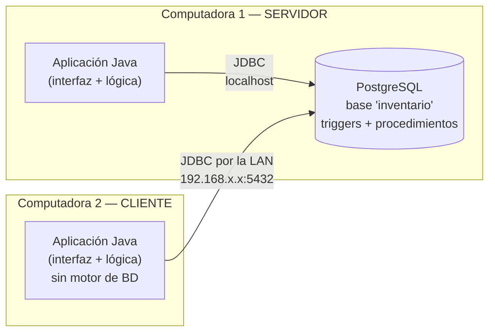

# Instalación en red local: una computadora como servidor

> **¿Prefiere que las otras PC no instalen nada?** Use la **versión web**: solo el
> servidor la instala y los demás abren el navegador. Guía: [VERSION_WEB.md](VERSION_WEB.md).
> Esta página describe la versión de escritorio (Java en cada computadora).



- **Las dos computadoras ejecutan el mismo programa** (`sistema-gestion.jar`).
  La única diferencia es la dirección del servidor en la pantalla
  *Configurar conexión*: `localhost` en el servidor y la IP del servidor en cada cliente.
- **La base de datos es única**: vive solo en la computadora 1. Los clientes no
  instalan PostgreSQL.
- Puede haber tantos clientes como necesite; el servidor serializa los
  movimientos de stock, de modo que dos cajas que venden el último producto
  a la vez nunca dejan el stock negativo.

## Requisitos

| | Servidor (Computadora 1) | Cliente (Computadora 2, 3, …) |
|---|---|---|
| Java 17 o superior ([Adoptium](https://adoptium.net)) | ✔ | ✔ |
| PostgreSQL 15 o superior ([descarga](https://www.postgresql.org/download/windows/)) | ✔ | ✘ |
| `sistema-gestion.jar` y `EJECUTAR_SISTEMA.bat` | ✔ | ✔ |
| Misma red local (cable o Wi-Fi del mismo router) | ✔ | ✔ |

## Forma rápida (recomendada)

1. Instale PostgreSQL en el servidor.
2. Descargue y descomprima [`descargas/SistemaGestion-Windows.zip`](../descargas/SistemaGestion-Windows.zip).
3. Doble clic en `INSTALAR.bat` → escriba la contraseña de `postgres`.
4. En cada cliente: instale Java, copie la carpeta `PARA_COMPUTADORAS_CLIENTE` y abra `EJECUTAR_SISTEMA.bat`
   (ya trae la IP del servidor y la contraseña de red configuradas).

Las secciones siguientes describen la instalación manual paso a paso.

## 1. Obtener el programa

Descargue el artefacto **sistema-gestion** de la última ejecución de GitHub
Actions (pestaña *Actions* del repositorio), o compílelo:

```bash
cd aplicacion
mvn package          # genera aplicacion/target/sistema-gestion.jar
```

## 2. Preparar la computadora SERVIDOR (Windows)

1. Instale PostgreSQL (anote la contraseña del usuario `postgres`) y Java.
2. Copie la carpeta completa del proyecto al servidor y coloque `sistema-gestion.jar`
   en la raíz de esa carpeta (junto a `sql\`).
3. Doble clic en `INSTALAR.bat` (en el repositorio: `instalacion\windows\INSTALAR.bat`).
   El instalador:
   - crea la base `inventario` con tablas, triggers y procedimientos;
   - genera una **contraseña de red** aleatoria para el usuario `app_inventario`
     (el que usan las aplicaciones; no puede alterar el kardex) y la guarda en
     `conexion.properties` junto al `.jar`;
   - configura PostgreSQL para escuchar en la red (`listen_addresses`) y
     autoriza solo a su subred en `pg_hba.conf` (deja copias `.respaldo`);
   - abre el puerto 5432 en el Firewall de Windows **solo para la subred local**;
   - crea el icono del escritorio y la carpeta `PARA_COMPUTADORAS_CLIENTE`
     (con la IP del servidor ya configurada) y muestra la **IP del servidor**.

   El instalador pregunta si desea cargar datos de ejemplo.
4. Recomendado: reserve una **IP fija** para el servidor en su router; si la IP
   cambia, los clientes dejarán de encontrarlo.
5. El sistema se abre solo con la conexión ya configurada. Si alguna vez debe
   configurarla a mano (botón *Configurar conexión...*), use:

   | Campo | Valor |
   |---|---|
   | Servidor | `localhost` |
   | Puerto | `5432` |
   | Base de datos | `inventario` |
   | Usuario de red | `app_inventario` |
   | Contraseña de red | la que figura en `conexion.properties` |

6. Inicie sesión con **admin / admin123**; el sistema le pedirá cambiarla.
   Cree los usuarios de los demás trabajadores en **Usuarios**.

> **Servidor Linux:** `./install.sh inventario --clave-app 'CLAVE'` y luego
> `sudo instalacion/linux/habilitar_red.sh 192.168.1.0/24`.
> **Docker:** `APP_PASSWORD=CLAVE docker compose up -d`.

## 3. Preparar cada computadora CLIENTE

1. Instale Java y copie `sistema-gestion.jar` y `EJECUTAR_SISTEMA.bat`.
2. Ejecute `EJECUTAR_SISTEMA.bat`. La primera vez aparece *Conexión al servidor*:
   escriba la **IP del servidor** (por ejemplo `192.168.1.10`) y la contraseña
   de red; pulse **Probar conexión** y luego **Guardar**.
3. Inicie sesión con su usuario.

La configuración queda en `%USERPROFILE%\.sistema-gestion\conexion.properties`
y puede cambiarse desde el botón **Configurar conexión...** del inicio de sesión.

## Roles de usuario

| Sección | Administrador | Almacenero | Vendedor |
|---|:-:|:-:|:-:|
| Inicio (indicadores y alertas) | ✔ | ✔ | ✔ |
| Usuarios, Almacenes | ✔ | | |
| Productos | ✔ editar | ✔ editar | ✔ consulta |
| Ventas | ✔ + mermas, consumos, ajustes | ✔ + mermas, consumos, ajustes | ✔ solo ventas |
| Compras, Transferencias | ✔ | ✔ | |
| Reportes (kardex, stock, lotes, ventas, documentos) | ✔ + anular documentos | ✔ | ✔ |

## Seguridad

- Las contraseñas de los usuarios se guardan cifradas con **bcrypt** en el
  servidor; la aplicación nunca las lee. Tras 5 intentos fallidos el usuario
  se bloquea 5 minutos.
- El usuario de red `app_inventario` solo puede **leer** y mantener
  almacenes/productos. Ventas, compras, transferencias y anulaciones pasan
  obligatoriamente por los procedimientos almacenados (`SECURITY DEFINER`),
  así que ni siquiera alguien con la contraseña de red puede saltarse las
  validaciones de stock ni modificar el kardex.
- Cada documento registra el usuario de la aplicación que lo emitió.
- El usuario `postgres` **no** puede conectarse desde la red.
- Los permisos por rol de la tabla anterior los aplica la aplicación; la
  contraseña de red (guardada en `conexion.properties`) debe tratarse como
  confidencial.

## Solución de problemas

| Mensaje | Causa probable / solución |
|---|---|
| *No se pudo conectar al servidor …* | Servidor apagado, IP incorrecta o firewall. Desde el cliente: `Test-NetConnection 192.168.1.10 -Port 5432` (PowerShell) debe indicar `TcpTestSucceeded : True`. |
| *no pg_hba.conf entry for host …* | El cliente está en otra subred. Vuelva a ejecutar el instalador del servidor conectado a esa red, o agregue la subred en `pg_hba.conf`. |
| *El servidor rechazó el usuario o la contraseña* | Contraseña de red incorrecta en *Configurar conexión*. |
| *La base de datos "inventario" no existe* | Falta ejecutar el instalador del servidor. |
| Funcionaba y dejó de conectar | La IP del servidor cambió: fíjela en el router y actualice los clientes. |

## Copias de seguridad

En el servidor (programar a diario con el Programador de tareas):

```bat
"C:\Program Files\PostgreSQL\16\bin\pg_dump.exe" -U postgres -Fc -f "D:\respaldos\inventario_%date:~-4%%date:~3,2%%date:~0,2%.backup" inventario
```

Restaurar: `pg_restore -U postgres -d inventario --clean archivo.backup`.
