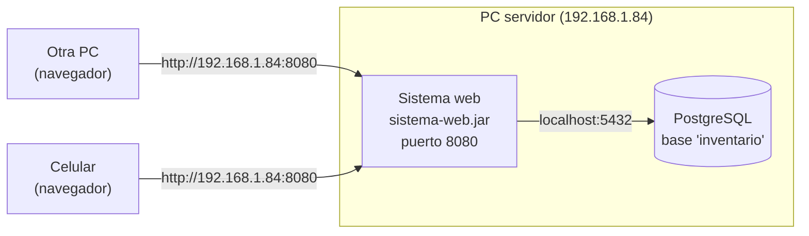
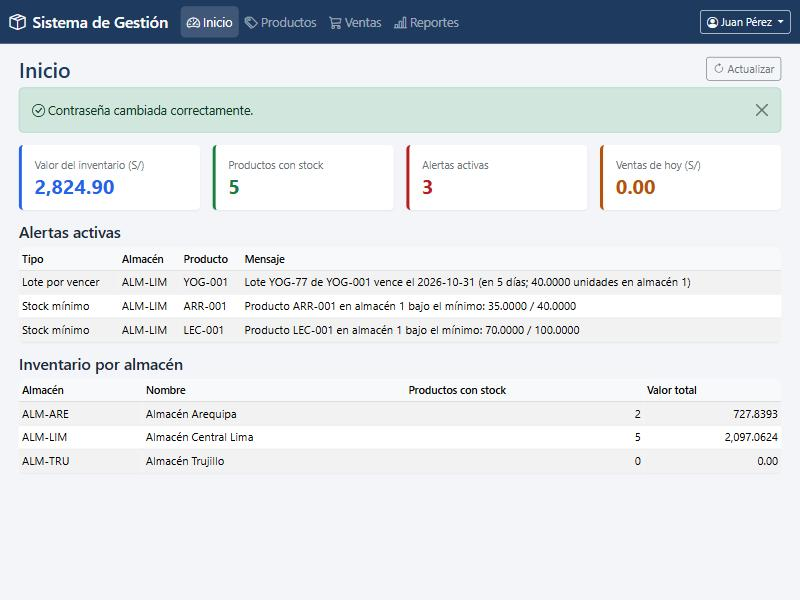
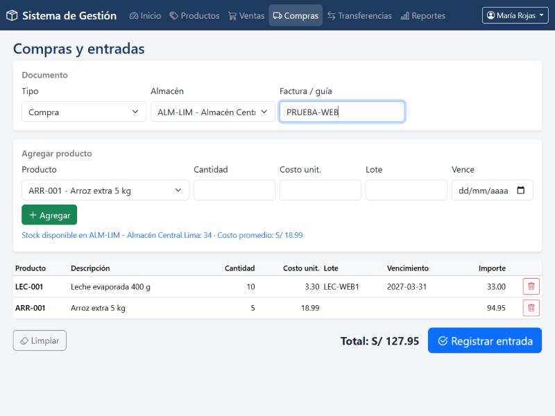
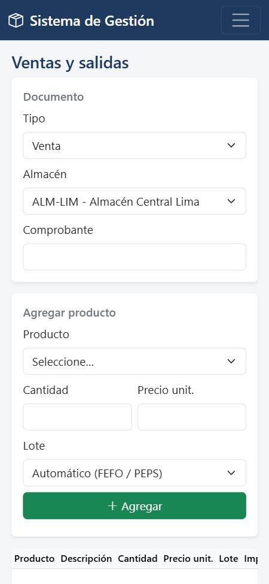

# Versión web — guía rápida

Con la versión web, **solo la computadora servidor** tiene instalado el sistema.
Las demás computadoras y los celulares conectados al mismo Wi-Fi o router abren
el **navegador** (Chrome, Edge, Firefox, Safari) y escriben la dirección del servidor.
No instalan Java ni ningún otro programa.



| Inicio | Compras (con lotes) | Celular |
|---|---|---|
|  |  |  |

---

## 1. Instalar en la PC servidor (una sola vez)

Requisito: la base de datos ya instalada con `instalacion\windows\INSTALAR.bat`
(ese instalador crea el archivo `conexion.properties` con la contraseña de red).

1. Abra el **Explorador de archivos** y entre a la carpeta del proyecto →
   `instalacion` → `windows`.
2. Haga **clic derecho** sobre **`INSTALAR_WEB.bat`** → **Ejecutar como administrador** →
   acepte el aviso de Windows.
3. Espere. La primera vez descarga componentes y tarda unos minutos.
   Al final la ventana muestra en amarillo la dirección para las otras PC, por ejemplo
   `http://192.168.1.84:8080`, y se abre el navegador.

El instalador:

- copia el programa a `C:\Program Files\SistemaGestionWeb`;
- lo deja **arrancando solo al encender la PC** (no hace falta iniciar sesión en Windows)
  y lo reinicia si se detiene;
- abre el puerto **8080** en el Firewall **solo para la red local** (desde internet no se puede entrar);
- crea el icono **"Sistema de Gestión (web)"** en el escritorio.

> Si vuelve a ejecutar `INSTALAR_WEB.bat` (por ejemplo, después de actualizar el
> proyecto), se instala la versión nueva encima, sin perder datos.

## 2. Usar desde las otras computadoras y celulares

1. Conéctelos al **mismo Wi-Fi o router** que la PC servidor.
2. Abra el navegador y escriba: **`http://192.168.1.84:8080`**
3. Ingrese con su usuario y contraseña.

Consejos:

- **Guárdela como favorito** (estrella de la barra de direcciones). En el celular use
  *Agregar a pantalla de inicio* para tener un icono.
- La sesión se **cierra sola tras 30 minutos sin uso**. Si ve "Su sesión se cerró
  por inactividad", vuelva a ingresar.
- Si la IP del servidor cambia, la página deja de abrir. Para evitarlo, reserve la IP
  `192.168.1.84` para la PC servidor en el router (opción *DHCP estático* o
  *Reserva de dirección*) o pida ayuda a quien administra el router.

## 3. Usuarios y permisos

| Rol | Puede |
|---|---|
| **Administrador** | Todo: usuarios, almacenes, productos, ventas, compras, transferencias, reportes y anular documentos |
| **Almacenero** | Productos y stock mínimo, ventas y otras salidas (merma, consumo…), compras, transferencias y reportes |
| **Vendedor** | Ventas, consulta de productos y reportes |

- Al crear un usuario o restablecer su contraseña, el sistema le **obliga a cambiarla**
  en su primer ingreso.
- Tras 5 contraseñas incorrectas seguidas, el usuario queda bloqueado 5 minutos.
- Si un administrador desactiva a un usuario o le cambia el rol, su sesión abierta se cierra
  en el siguiente clic.

Usuarios de demostración (si instaló los datos demo): `jperez` (vendedor) y `mrojas`
(almacenero) con contraseña inicial `demo123`.

## 4. Preguntas frecuentes

**La página no abre en otra PC.**
1. En la PC servidor, abra el icono del escritorio. Si tampoco abre, reinicie la PC servidor.
2. Verifique que ambas estén en la misma red (mismo Wi-Fi).
3. Confirme la IP del servidor: en la PC servidor abra *Símbolo del sistema* y escriba
   `ipconfig` (línea *Dirección IPv4*).

**¿Dónde veo errores?** En la PC servidor: `C:\Program Files\SistemaGestionWeb\logs\sistema-web.log`.

**¿Cómo detengo o desinstalo la versión web?** Clic derecho sobre
`instalacion\windows\DESINSTALAR_WEB.bat` → *Ejecutar como administrador*.
Los datos del inventario **no se borran** (están en PostgreSQL).

**¿Sigue funcionando la versión de escritorio?** Sí, ambas usan la misma base de datos
y pueden usarse a la vez. Si ya nadie usa la versión de escritorio desde otras PC, puede
quitar la regla del Firewall del puerto 5432 para que la base de datos solo sea accesible
desde la propia PC servidor.

## 5. Seguridad (resumen técnico)

- Las contraseñas se verifican **dentro de PostgreSQL** con bcrypt (`fn_login`); la web no las guarda.
- La contraseña de red de la base está solo en `conexion.properties` (ignorado por git), legible
  únicamente por administradores y por la cuenta limitada *Servicio local* con la que corre el sistema.
- Todos los formularios llevan protección **CSRF**; los permisos por rol se validan en el servidor
  en cada dirección, no solo ocultando botones.
- Cabeceras de seguridad: CSP sin código externo, sin incrustación en otros sitios (`frame-ancestors 'none'`).
- La comunicación en la red local es **HTTP sin cifrar**: úsela solo en su red de confianza
  (no la publique a internet ni abra el puerto 8080 en el router).

## 6. Para programadores

```bash
# Compilar y ejecutar las pruebas (no requiere Maven instalado)
cd web
./mvnw package            # Windows: .\mvnw.cmd package

# Ejecutar sin instalar (usa ../conexion.properties); detenga antes el sistema instalado
java -jar web/target/sistema-web.jar
```

En VS Code: tarea **Web: compilar** / **Web: ejecutar para probar**, o **F5** →
*Sistema web (http://localhost:8080)*.

| Parte | Archivo |
|---|---|
| Conexión a PostgreSQL | `web/src/main/java/pe/sistema/web/config/` |
| Seguridad (login, roles, CSRF, sesiones) | `web/src/main/java/pe/sistema/web/seguridad/` |
| Llamadas a procedimientos `sp_*` y consultas | `web/src/main/java/pe/sistema/web/datos/` |
| Pantallas (controladores) | `web/src/main/java/pe/sistema/web/controlador/` |
| Páginas HTML (Thymeleaf + Bootstrap) | `web/src/main/resources/templates/` |
| Instalador Windows | `instalacion/windows/INSTALAR_WEB.bat` + `instalar_web.ps1` |
